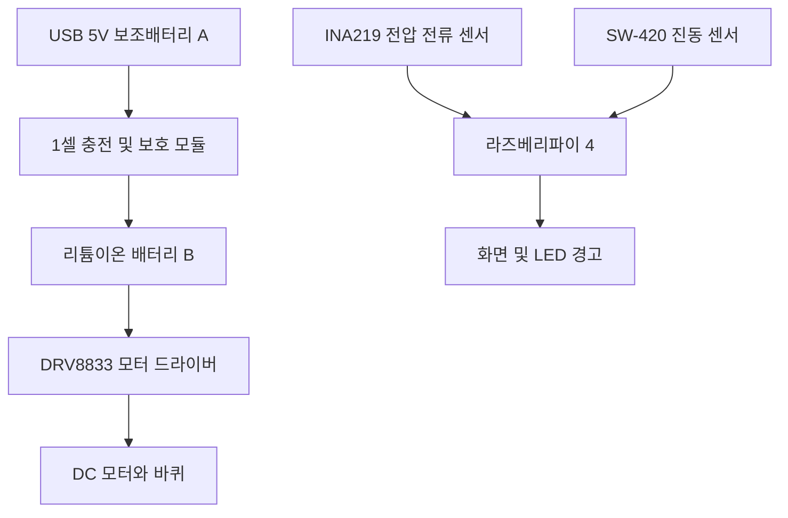

# 전기차 비상 보조전원 MVP

## 한 줄 소개
전기차의 배터리 방전 상황을 축소해 외부 전원으로 배터리를 충전하고 모터를 구동하는 과정을 확인하기 위한 저전압 모형입니다.

## 프로젝트 배경과 목표
전기차의 주행 배터리가 부족할 때 충전소까지 이동하기 어렵고 긴급출동을 기다려야 하는 상황에 착안했습니다. 팀은 비상전원으로 주행용 배터리를 충전하는 흐름을 소형 모형으로 표현하고, 전압·전류 측정과 진동 경고를 함께 시연하는 것을 목표로 합니다.

- 비상 충전: USB 5V 보조배터리 A로 충전 모듈을 거쳐 1셀 배터리 B 충전
- 구동: 충전 종료 및 분리 후 배터리 B로 모터 구동
- 감지: SW-420 진동 감지 후 LED와 화면에 경고 표시

> 이 프로젝트는 실제 전기차가 아닌 저전압 축소 모형입니다. 실제 차량의 고전압 충전이나 안전성·호환성을 입증한 결과가 아닙니다.

## 시스템 블록도
손그림 원본은 추후 추가합니다. 아래 구성은 기존 MVP 사양서를 기준으로 정리한 계획입니다.

충전과 모터 구동은 별도 단계로 진행합니다. 라즈베리파이는 별도 안정 전원으로 공급합니다. INA219가 입력측에 있을 경우 표시 전류는 배터리의 실제 충전전류와 다를 수 있습니다.

## 사용 부품과 기술

| 부품 | 용도 및 계획 사양 | 수량 |
|---|---|---:|
| Raspberry Pi 4 Model B 2GB | 센서값 처리 및 화면 표시 | 1 |
| USB 5V 보조배터리 A | 비상 충전 전원 | 1 |
| 보호회로 내장 1셀 리튬이온 배터리 B | 모형 구동용 전원, 공칭 3.7V | 1 |
| 1셀 충전·보호 모듈 | USB 5V 입력, 4.2V CC/CV 충전 | 1 |
| DRV8833 | DC 모터 구동 제어 | 1 |
| DC 모터 및 차체 | 3~6V 모터와 바퀴 구동 | 1식 |
| INA219 | 전압·전류 측정 | 1 |
| SW-420 | 진동 감지 | 1 |
| LED·저항·스위치·배선 | 경고 표시, 조작 및 연결 | 1식 |
| microSD 및 Pi 전원 | 운영체제 및 별도 전원 공급 | 1식 |

소프트웨어는 라즈베리파이에서 센서 측정값과 경고 상태를 표시할 계획입니다. 실제 사용한 운영체제, 코드, 라이브러리 이름과 버전은 확정 후 기록합니다.

## 실행 및 시연 계획

1. 배터리와 충전·보호 모듈의 사양 및 배선을 점검하고, 배터리 B를 미리 안전한 충전 상태로 준비합니다.
2. 라즈베리파이에 별도 전원을 공급하고 화면과 측정 장치를 준비합니다.
3. 보조배터리 A를 충전 모듈에 연결하고 INA219의 설치 위치에서 전압·전류가 표시되는지 확인합니다.
4. 충전을 종료하고 케이블을 분리한 뒤 배터리 B와 모터 드라이버를 통해 바퀴 회전을 확인합니다.
5. SW-420에 진동을 주어 LED와 화면 경고를 확인합니다.
6. 전체 과정을 60~90초 시연으로 구성합니다.

실제 연결 핀, 실행 명령, 스위치 조작 순서 및 확인 결과는 제작 후 추가합니다. 짧은 충전만으로 완전 방전된 배터리가 회복된 것처럼 표현하지 않습니다.

## 시연 영상 또는 GIF
촬영 후 링크 추가 예정: [시연 영상 링크]

## 트러블슈팅

> 아래 내용은 논의한 어려움을 바탕으로 구성한 작성 초안입니다. 실제 작업과 다른 부분, 확인한 결과와 해결 과정은 팀에서 수정합니다.

### 1. 부품이 많아 배선과 전원 연결을 구분하기 어려웠다
- **상황:** 보조배터리, 리튬이온 배터리, 충전·보호 모듈, 모터 드라이버와 센서를 각각 연결해야 해서 전원선과 신호선을 한눈에 구분하기 어려웠습니다.
- **접근:** USB 전원에서 충전 모듈과 배터리로 이어지는 충전 경로, 배터리에서 모터 드라이버로 이어지는 구동 경로를 나누어 정리했습니다. 각 모듈의 전원·접지·신호 핀과 사용 전압도 확인하도록 배선도를 점검했습니다.
- **확인할 결과:** 실제 배선 과정에서 틀렸던 연결, 수정한 위치와 동작 여부를 제작 후 추가합니다.
- **배운 점:** 전체 회로를 한 번에 연결하기보다 기능별로 나누어 핀과 전원을 확인하면 문제 위치를 찾기 쉽다는 것을 배웠습니다.

### 2. 라즈베리파이와 센서 사용이 익숙하지 않았다
- **상황:** 라즈베리파이를 이용해 센서값을 읽고 화면에 표시하는 과정과 GPIO 핀의 역할이 익숙하지 않아 준비에 어려움을 겪었습니다.
- **접근:** 라즈베리파이의 핀 배치와 3.3V 신호를 확인하고, INA219의 I2C 연결과 SW-420의 디지털 신호 연결 방법을 각각 조사했습니다. 센서별로 연결과 동작을 먼저 확인한 뒤 하나의 화면에 표시하는 순서로 정리했습니다.
- **확인할 결과:** 실제 설치한 프로그램과 라이브러리, 발생한 오류와 해결 여부는 작업 후 추가합니다.
- **배운 점:** 처음 사용하는 장비는 전체 기능을 동시에 구현하기보다 전원과 센서를 하나씩 확인하고 문제를 나누어 살펴보는 것이 중요하다는 점을 배웠습니다.

## 역할 분담

팀원 모두가 시제품 제작에 참여했습니다.

- **문승환:** 프로젝트 구상과 설계, 자료 조사, 전체 구성 정리, 발표자료 작성 및 발표를 주도하고 시제품 제작에 참여했습니다.
- **성현욱:** 팀장으로서 아이디어를 제공하고 자료의 최종 검토·수정을 맡았으며 시제품 제작에 참여했습니다.
- **서의환:** 아이디어와 프로젝트 방향을 제안하고 시제품 제작에 참여했습니다.
- **최문근:** 아이디어를 제안하고 시제품 제작에 참여했습니다.

## 배운 점
부품 하나의 기능만 보는 것이 아니라 전원의 흐름, 부품별 전압, 보호회로와 제어 신호를 함께 살펴야 시스템을 이해하고 설명할 수 있다는 점을 배웠습니다.

## 향후 보완
- 실제 배선도와 손그림 블록도 첨부
- 실제 부품 모델명, 라이브러리 버전 및 실행 코드 추가
- 충전·모터·진동 감지 결과와 측정값 기록
- 시연 영상 및 문제 해결 기록 추가